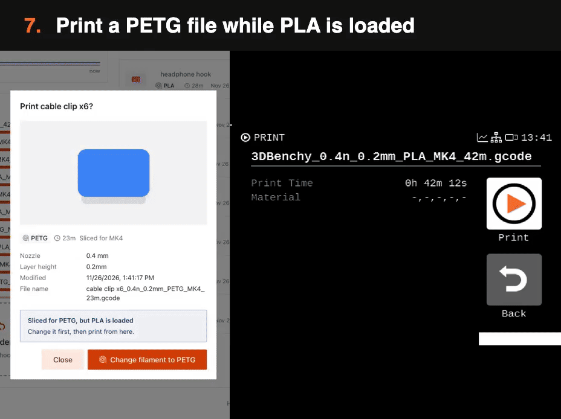
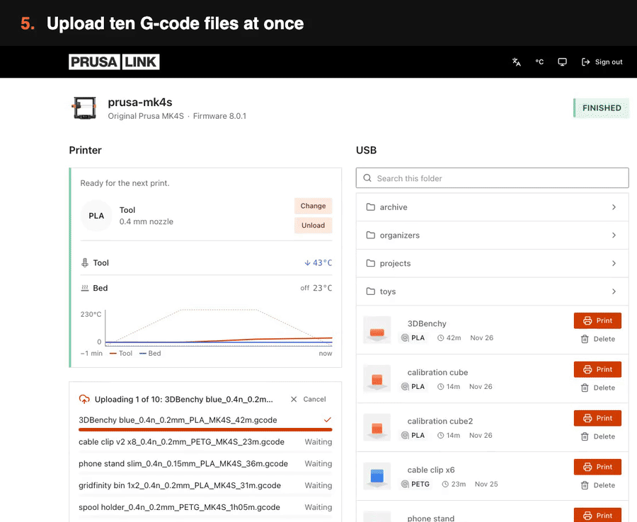
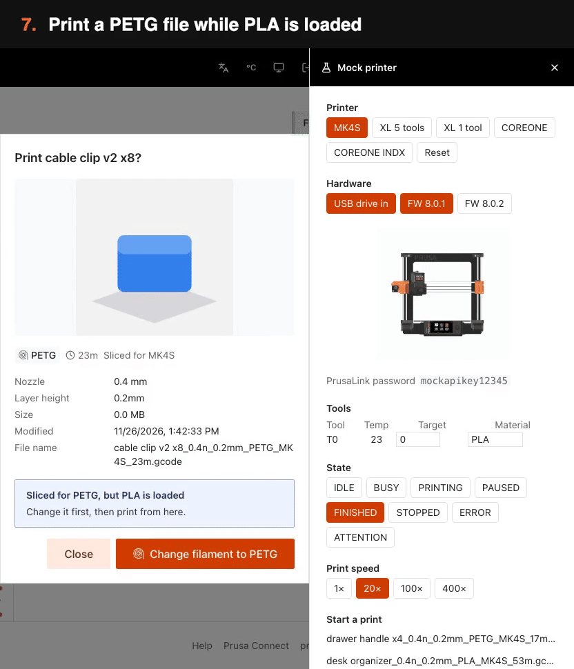
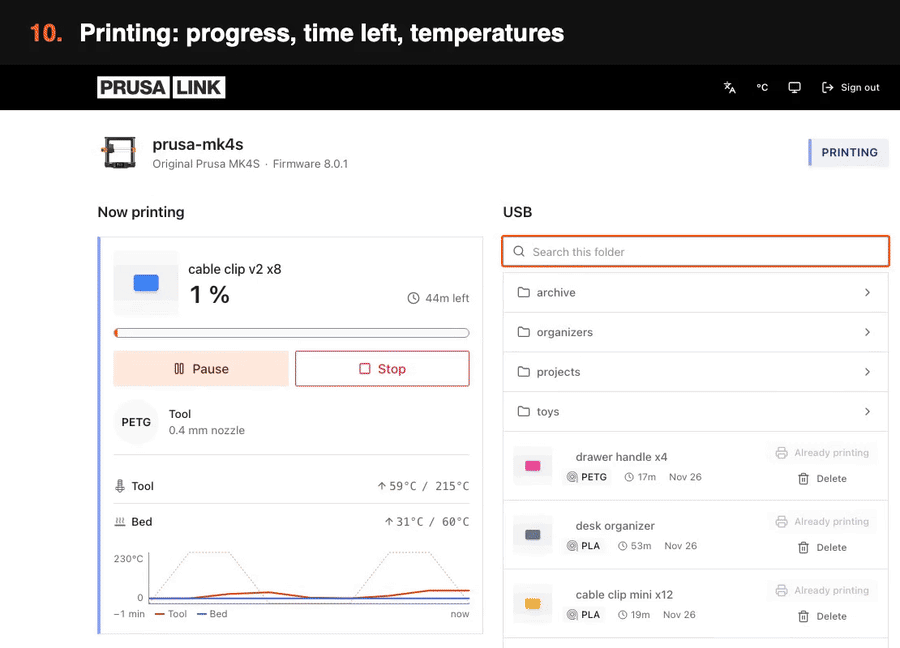

# PrusaLink Web 2

The web interface the Buddy firmware serves (MINI, MK3.5, MK4/MK4S, XL, CORE One,
CORE One L, CORE One INDX, iX). It ships as one self-contained `index.html`,
nothing else. `make build` makes a generic one (`dist/generic/`), which the
firmware embeds for every printer for now, and one per printer
(`dist/<printer>/`, with the printer's picture and favicon) for when it picks
its own. The MINI's firmware ships per language, so it gets one build per
language (`dist/mini-<lang>/`) carrying that language only; every other build
carries all nine. Each folder also has `index.html.gz` and `favicon.ico.gz`,
gzipped exactly as the firmware embeds them.

Budget, gzipped as the firmware stores it: 80 KB for the MINI builds, 100 KB for
every other printer, enforced by `pnpm build`.

|                                                                                                                  |                                                                                              |
| ---------------------------------------------------------------------------------------------------------------- | -------------------------------------------------------------------------------------------- |
|        |  |
| Against the real firmware in the simulator: a file sliced for PETG while PLA is loaded, swapped from the browser | Uploading several files with per-file progress, then searching                               |
|      |             |
| Printing a file sliced for another material, on the mock printer                                                 | Pause asks first, then waits for the printer                                                 |

## Try a build against any printer

`make package` zips every build with `serve.mjs`. Anyone with Node.js runs
`node serve.mjs http://<printer-ip> [printer]` and opens http://localhost:5970/:
it serves the page and forwards the API to that printer, without flashing it.
Opening `index.html` from disk does not work: the firmware answers no
cross-origin requests. From the repo: `make serve PRINTER_URL=http://<printer-ip>`.

## API

The page uses the PrusaLink REST API (`spec/openapi.yaml`, synced from the
Prusa-Link-Web master). `/api/version`, `/api/printer` and `/api/job` also answer
like OctoPrint, for OctoPrint-compatible tools; the page links both from its
footer.

Stack and rules follow [prusa-connect's frontend](https://github.com/Prusa-Research/prusa-connect/tree/main/frontend):
Svelte 5 (runes) + TypeScript + Vite, Tailwind 4 on the Prusa Design System tokens
(`src/styles/tokens.css`, copied from `@prusa/connect-ui`), Vitest (Chromium for
components), Playwright, Storybook, and `@prusa/frontend-standards` for ESLint,
Prettier and tsconfig. Read `../prusa-connect/packages/standards/rules/*.md`.

## Start

```bash
make
```

Installs whatever is missing (needs Node.js 22.12+, see `.nvmrc`; pnpm comes
through corepack), syncs the API spec, starts the dev server with the mock
printer on port 5957 (`make DEV_PORT=…` to change) and opens the app signed in. The mock's dev panel is at `/dev/panel.html`.
`make help` lists the rest. `@prusa/frontend-standards` is not on npm yet, so it
comes from the public `prusa3d/prusa-connect` repository, pinned by commit.

## Develop

`make help` lists everything. The usual loop:

| Command                        | What                                                                                |
| ------------------------------ | ----------------------------------------------------------------------------------- |
| `make dev`                     | App + mock printer. Dev panel: `/dev/panel.html` (model, state, tools, start print) |
| `make sim` then `make dev-sim` | Firmware in the simulator, app proxied to it (the dev server adds the API key)      |
| `make check` / `make e2e`      | Lint, format, types, unit and component tests / Playwright                          |
| `make build`                   | `dist/<printer>/index.html` for every printer + size budget check                   |
| `make fw-build PRINTER=mk4`    | Build, copy into the firmware checkout (`BUDDY`), build that firmware               |
| `make sim PRINTER=mk4`         | Run that firmware; the printer itself then serves this app on `PORT`                |

`BUDDY` defaults to `../Prusa-Firmware-Buddy-prusalink2`, a Buddy worktree whose
`src/resources/web/` holds only `index.html`. Simulators come from `../buddy-dev-env`.

## The API contract

`spec/openapi.yaml` is the PrusaLink API, pinned by commit in `spec/source.json`
(today `prusa3d/Prusa-Link-Web` master; it moves to Buddy once the spec lives there).
`dev`, `build`, `test` and `check` run `spec:sync` first, which downloads only when
the file does not match the pin, so offline work keeps going. `make spec-update`
moves the pin to the newest upstream commit; CI checks daily for a newer one.

Generated types (`src/lib/api/schema.d.ts`) type both the app's client and the mock
(`mock/api.ts`), so a spec change the mock does not follow fails type-checking, and
`mock/api.test.ts` checks mock responses against the spec's schemas.

## Layout

- `src/features/<feature>/` screens (status, files, upload, print)
- `src/lib/api/` the only place that talks HTTP
- `src/lib/stores/` class stores in `.svelte.ts`
- `src/lib/ui/` primitives (prusa-connect class names, no bits-ui)
- `src/locales/en.json` every user-facing string (`t()`); the other printer languages beside it,
  built into the page as compact lists (`mock/locales.ts`)
- `mock/`, `dev/` dev-server only, never in the build

## License

GPL-3.0, as the PrusaLink web interface on master: see [LICENSE](LICENSE).
